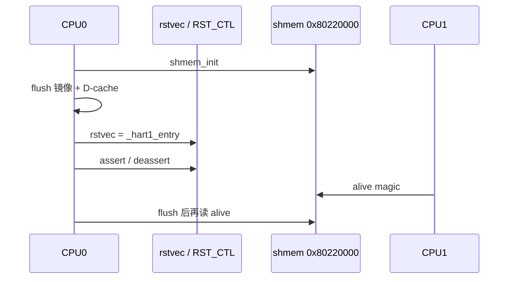

# 02 · 多核启动

> 前置：01（CPU0 + UART）。  
> 本课代码是**完整固件**；这里写相对 01 **多出来的部分**。  
> 寄存器级细节见同目录 [K230_DUAL_CORE_CN.md](K230_DUAL_CORE_CN.md)。

01 证明 CPU0 能打印。本课证明：**CPU0 能把关在复位里的 CPU1 放到指定 PC 上跑**，并且两核能通过 SRAM 看见对方。

---

## 要证明的对比

| 做法 | 期望 |
|------|------|
| 只加载镜像、不解复位 | 只有 CPU0；shmem `alive` 一直否 |
| 写 `rstvec` + 脉冲 `CPU1_RST_CTL` | CPU1 从 `_hart1_entry` 起来，`alive=0xC001F00D` |
| 解复位前 **不** flush D-cache | CPU1 可能跑飞（看见的是旧 SRAM） |
| `i` 写 CLINT MSIP[1] | 已在跑的 CPU1 能看见 IPI（`ipi_seen` 增加） |
| 只写 MSIP、核还在复位 | **叫不醒**——IPI 不解复位 |

---

## 硬件路径

K230 是**不对称启动**：CPU0 始终可跑；CPU1（大核）上电关在 RMU 复位里。  
叫醒它靠 **SoC 复位控制**，不是 SBI，也不是邮箱。

```text
CPU0 main
  → 写 0x91102104 = _hart1_entry
  → 脉冲 0x9110100c（bit0 + bit16 写使能）
  → CPU1 PC ← rstvec
       _hart1_entry → thead_cpu_init → 独立栈 _sp1 → hart1_main
```



| 项 | 值 |
|----|-----|
| `cpu1_hart_rstvec` | `0x91102104` |
| `CPU1_RST_CTL` | `0x9110100c`；改 bit N 必须同时写 bit N+16 |
| 断言 / 解除 | `0x00010001` / `0x00010000` |
| shmem | `0x80220000` 起 64B（`alive` / `state` / `cmd` / `wake` / `ipi`） |
| CLINT | `0xf04000000`；`MSIP[hart] = base + 4*hart` |
| CPU1 栈 | `_sp1`（**不能**和 CPU0 共用 `_sp`） |

`RST_CTL` 上电约 `0x2001`（bit0=1，核在复位）。只写「清 done」`0x10001000` **不会**解复位。

两核各有 L1。CPU0 写过的入口代码 / `.data` / shmem，解复位前必须 `thead_flush_caches()` / `thead_flush_range`。读 CPU1 的 `alive` 前也要 flush，否则 CPU0 自己的 D-cache 还留着 0。

硬件**没有**「是否在 WFI」位。菜单上的 RUNNING / SOFT_LOOP / WFI 是 shmem 软件协议。

---

## 菜单（CPU0）

```text
[M] s    读 shmem：alive / state / wake / ipi
[M] 1    令 CPU1 进入 running
[M] 2    令 CPU1 进 soft-loop
[M] 3    令 CPU1 进 WFI
[M] i    向 hart1 写 MSIP，看 ipi_seen
[M] c    清 CPU1 MSIP
[M] q    关 cache，停给 J-Link
```

CPU1 周期性打 `[cpu1] tick N`。大核上 `mcycle` **可能不递增**，所以 tick 延时用软件循环，不要用 `mcycle` 空等——否则会表现为「完全没有 cpu1 打印」。

### 期望

| 现象 | 判定 |
|------|------|
| `cpu1: ok` / `alive=yes` | 解复位 + flush + 独立入口都对 |
| 只有 CPU0、永远无 tick | rstvec / 复位脉冲 / cache / `_hart1_entry` |
| `ipi` 不变且核在复位 | 先 `s` 看是不是还没 released |
| tick 把 CPU0 菜单冲乱 | 正常：两核都能写 UART，没有锁（锁是 10） |

---

## 常见误区

1. **「CLINT IPI 就能拉起第二核」**  
   MSIP 只能打**已经在跑**的 hart。还在复位里的核取不到指。

2. **「rstvec 写成 `_start`」**  
   CPU1 会再清 `.bss`、再用 `_sp`，把 CPU0 毁掉。

3. **「shmem 写了对方立刻能读」**  
   各有 D-cache。协议块每次读写前后 `thead_flush_range`。

4. **「`mhartid` 在 CPU1 上用来做延时」**  
   延时用软件循环；`mcycle` 在大核上不可靠。

5. **bit16 当「复位状态」读**  
   bit16 是**写使能**。是否在复位看 **bit0**。

---

## 关键文件

| 文件 | 作用 |
|------|------|
| `arch/riscv/start.S` | `_start`（CPU0）+ `_hart1_entry`（CPU1） |
| `boards/k230/cpu1.c` | 上电、rstvec、复位脉冲 |
| `src/shmem.c` | 软件协议 |
| `src/hart1_main.c` | CPU1 状态机 + tick |
| `boards/k230/clint.c` | MSIP |
| `arch/riscv/cache.S` | flush / `thead_cpu_init` |

寄存器表、时序、和 Linux/OpenSBI 的差别：[K230_DUAL_CORE_CN.md](K230_DUAL_CORE_CN.md)。

---

## 不做

原子加、PLIC、页表。本课只解决「第二核活着 + 能看见 shmem」。

---

## 构建

```bash
cd 02-multi-cpu && make
```

可选 `make LOAD=ddr`（DRAM 须已初始化）。

下一课：[03-exception](../../03-exception/docs/EXCEPTION_CN.md)

返回：[本目录 README](../README.md) · [文档索引](../../docs/README.md)
