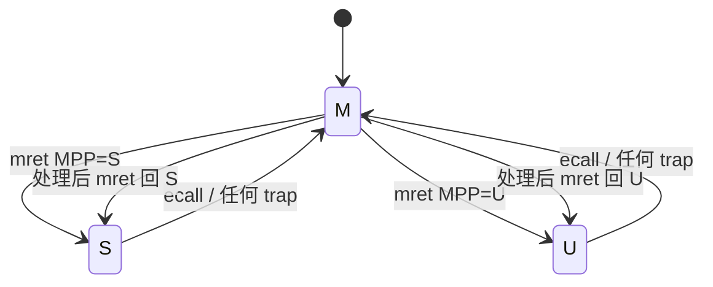

# 04 · 特权级切换（M / S / U）

> 前置：01 串口、03 trap。  
> 本课：**先切模式，再在本模式测权限；异常处理后回到本模式**。

RISC-V **没有**「当前特权级」可读 CSR。要证明切成功，只能看 **ecall 的 `mcause`** 和 trap 时的 **`mstatus.MPP`**。

---

## 要证明的对比

| 当前模式 | `mhartid` | `sstatus` | `mstatus` | ecall `mcause` | trap 后 `MPP` |
|----------|-----------|-----------|-----------|----------------|---------------|
| M | 成功 | 成功 | 成功 | **11** | 3 |
| S | 异常（多为 2） | 成功 | 异常 | **9** | 1 |
| U | 异常 | 异常 | 异常 | **8** | 0 |

标准 M/S/U（无虚拟化）用 **8 / 9 / 11**，**不是** 8 / 9 / 10。10 是 Hypervisor 的 VS-ecall。

---

## 硬件路径

启动在 **M**。C908 **实现了 PMP**：上电若表为空，S/U 默认不能取指。本课启动时 `pmp_allow_all`（全空间 R/W/X）。进 S/U 后在 `0x80200000` 取指 fault，**不是**加载地址错了。

切到 S/U：写 `mstatus.MPP` + `mepc=目标 shell`，`mret`。  
S/U 再切走：执行 `ecall`（`a0` = 目标），M 的 handler 再 `mret` 到新 shell。

异常一律进 M（`medeleg=0`）。测试用 trap 会 skip 故障指令，`mret` **回原模式**（把 `MPP` 写回该级）。

```text
[M] s  →  MPP=S, mepc=shell_s, mret
[S] 1  →  读 mhartid → illegal → M dump → skip → mret 回 [S]
[S] u  →  ecall a0=U → M 看见 cause 9 → 再 mret 进 [U]
```



`priv_switch.S` 进 S/U 前会 `csrw satp, zero`。06 开页表时**不能**照抄这一步。

---

## 菜单

提示符显示当前级：`[M]` / `[S]` / `[U]`。

| 键 | 作用 |
|----|------|
| `1` | 读 `mhartid`（仅 M） |
| `2` | 读 `sstatus`（M/S） |
| `3` | 读 `mstatus`（仅 M） |
| `4` | 测试 `ecall`（看 cause） |
| `p` | 证明当前级：`mcause` + `MPP` |
| `m` / `s` / `u` | 切到该级 |
| `h` | 帮助 |

切模式的 ecall 与测试 ecall 硬件上都是 8/9/11。软件约定：`trap_expect=0` 且 `a0=1/2/3` 为切换；`trap_expect=1` 为测试，处理后回原模式。

### 期望

按上表。`p` 在 S 应打印 cause **9**、MPP **1**。  
进 S 立刻 instruction access fault：PMP 没放行。  
JTAG 不复位重载后读 M CSR 变 illegal：当前其实在 U。

---

## 常见问题

### 1. 有没有单独的「这是 ecall」标志？

**没有。** 和非法指令一样，只看 `mcause`：`irq==0` 且 code ∈ {8,9,11}。

### 2. 是用 8、9、10 区分的吗？

**不是。** 无虚拟化时是 8、9、**11**。本课不会看到 10。

### 3. 除了 `mcause` 还能靠什么？

`mstatus.MPP`：出异常**之前**的级。运行中没有「我现在是 S」可读 CSR。

### 4. 和非法指令差在哪？

| | `ecall` | 非法 CSR / 非法指令 |
|--|---------|---------------------|
| `mcause` | 8 / 9 / 11 | 多为 **2** |
| 含义 | 主动陷入 | 无权或编码非法 |

### 5. 提示符 `[M]` 是硬件的吗？

**不是。** 是软件变量 `g_cur_mode`。真凭据是 `p` 打出来的 cause + MPP。

---

## 关键文件

| 文件 | 作用 |
|------|------|
| `arch/riscv/priv_switch.S` | `mret` 进目标 shell；清 `satp` |
| `arch/riscv/trap_entry.S` | 压栈 → `trap_handler` → `mret` |
| `src/trap.c` | 区分切模式 / 测试 ecall；打印 MPP |
| `src/priv.c` | CSR、ecall、`prove_current_mode` |
| `src/main.c` | `shell_m` / `shell_s` / `shell_u` |

---

## 不做

PMP 拒绝区（05）、页表（06）、中断（08/09）。本课只建立「三级能进、能证明、能回来」。

---

## 构建

```bash
cd 04-privilege && make
```

下一课：[05-pmp](../../05-pmp/docs/PMP_CN.md)

返回：[本目录 README](../README.md) · [文档索引](../../docs/README.md)
