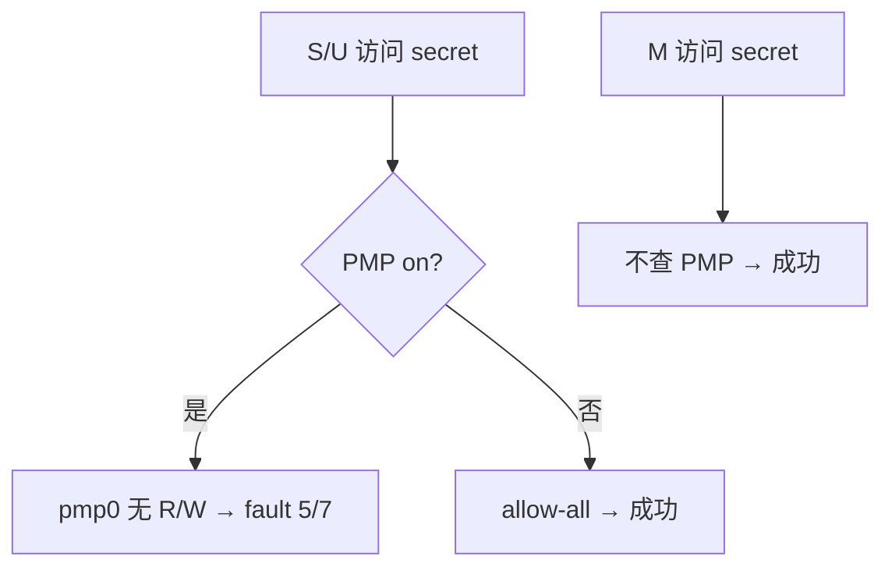

# 05 · PMP 保护区

> 前置：04 特权级。本课只做一件对比：**设一块拒绝区 → M/S/U 读写 → 取消 → 再测**。

04 已经 `pmp_allow_all`，否则进不了 S。本课在「全放行」之上再加一条：**某一 4K 对 S/U 拒绝**。

---

## 要证明的对比

| 模式 | PMP on（拒绝该 4K） | PMP off（全空间放行） |
|------|---------------------|------------------------|
| M | 读/写 **OK** | 读/写 OK |
| S | 读 trap **5** / 写 trap **7**，仍回 S | 读/写 OK |
| U | 同上，仍回 U | 读/写 OK |

未加锁时 **M 不看 PMP**（除非 `mstatus.MPRV`）。所以 on 时 M 仍能读写 secret，这不是 bug。

**off 不是把 PMP 表清空。** C908 实现了 PMP：一条授权都没有时，S/U 默认不能取指/访存，代码和 UART 会挂。取消保护 = 回到 04 那种 allow-all。

---

## 硬件路径

PMP 在 **物理地址** 上匹配，和页表无关（页表是 06）。检查发生在 S/U 的 load/store/fetch。

本课用 NAPOT：

| 项 | 内容 |
|----|------|
| pmp0 | secret 4K：**无** R/W/X，A=NAPOT → S/U 碰这块就 fault |
| pmp1 | SRAM 镜像范围 RWX |
| pmp2 | UART 64K RW |
| off | `pmpaddr0=-1` + `pmpcfg0` NAPOT RWX（与 04 相同） |

secret 在链接脚本 `.pmp_secret`，SRAM 上一般是 `0x80220000`，魔数 `0x50504d50`（`PMP`）。

`pmpcfg` / `pmpaddr` 只有 M 能写。S/U 写这些 CSR → illegal（cause 2）。菜单 `e`/`c` 不在 M 会拒绝。

```text
[M] e     装 pmp0 拒绝 + pmp1/2 放行
[S] 1     load secret → mcause=5，mtval=secret
[M] c     恢复 allow-all
[S] 1     读到魔数，无 trap
```

异常仍在 M 处理（`medeleg=0`），`mret` 回原模式，和 04 一样。



---

## 菜单

启动已是 **PMP: on**。提示符带当前级。

```text
[M] 1/2     读/写保护区：成功
[M] s → [S] 1/2     trap 5/7，仍回 S
[S] u → [U] 1/2     trap 5/7，仍回 U
[U] m → [M] c       取消保护
再进 S/U 按 1/2     成功
[M] e               再打开保护
```

| 键 | 作用 |
|----|------|
| `1` / `2` | 读 / 写 secret |
| `e` / `c` | 开 / 关（仅 M） |
| `m` / `s` / `u` | 切模式 |

### 期望

按第一张表。  
`e`/`c` 打出 `PMP CSR illegal`：当前不是 M（软件提示符不可信，先 `m` 或看 04 的 `p`）。  
关保护后 S 取指 fault：你把表清空了，而不是 allow-all。

---

## 常见误区

1. **「清空 PMP = 关掉保护」**  
   实现了 PMP 的核，空表对 S/U 是 **默认拒绝**。

2. **「M 也被挡才算 PMP 有效」**  
   默认 M 绕过。要让 M 也受约束得设锁或 `MPRV`，本课不做。

3. **「access fault 5/7 是页故障」**  
   页故障是 12/13/15（06）。PMP / 总线拒绝是 **access fault 1/5/7**。

4. **提示符 `[M]` 保证能写 pmpcfg**  
   `[M]` 是软件变量。JTAG 重载后可能人在 U。

5. **S 里改 PMP「只关匹配」**  
   写 CSR 本身就会 illegal；即便能写，关匹配的瞬间取指也可能挂。

---

## 关键文件

| 文件 | 作用 |
|------|------|
| `src/priv.c` | NAPOT 编码、`pmp_enable` / `pmp_clear`、测读写 |
| `src/main.c` | 菜单；`e`/`c` 仅 M |
| `src/trap.c` | 打印 cause，回原模式 |
| `boards/k230/linker.ld` | `.pmp_secret` 4K |

---

## 不做

页表、执行权限 X、PMP 锁位、TOR 多段。本课一块 4K 的 R/W 对比就够。

---

## 构建

```bash
cd 05-pmp && make
```

下一课：[06-tlb](../../06-tlb/docs/TLB_CN.md)

返回：[本目录 README](../README.md) · [文档索引](../../docs/README.md)
