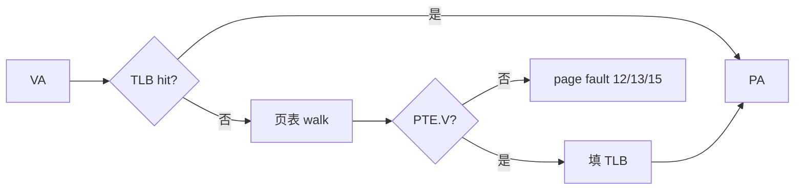

# 06 · Sv39 / TLB

> 前置：04 特权级、05 PMP。  
> 本课：**开页表，在 S 里看映射、缺页、以及 TLB 要不要 `sfence.vma`。**

PMP 看的是物理地址。本课看的是 **VA → PA**。两套同时存在：先 PMP allow-all，再开 `satp`。

---

## 要证明的对比

| 键 | 做法 | 期望 |
|----|------|------|
| `o` | 装三级页表，`satp=Sv39`，`mret` 进 S | 之后才能测 1/2/f |
| `1` | S 读已映射 `VA 0x1000` | 魔数 `0x544c4231`（`TLB1`），无 trap |
| `2` | S 读未映射 `VA 0x4000` | `mcause=13` Load page fault，`mtval=0x4000` |
| `f` | 清该 PTE 的 `V`，先读、再 `sfence.vma`、再读 | 第一步**可能**仍成功（旧 TLB）；fence 后应 fault 13 |

M-mode **不查 `satp`**（除非 `MPRV`）。在 `[M]` 按 `1`/`2` 走的是物理地址，**证明不了页表**。所以必须先 `o`。

---

## 为什么必须进 S

```text
M 写页表到 SRAM
  → 清 mxstatus.MAEE（0x7c0 bit 21）——玄铁扩展 PTE 和标准 Sv39 会打架
  → satp = MODE=Sv39 | PPN(L2)
  → MPP=S, mret
S 用 VA 取指/访存 → 硬件 walk 页表 / 查 TLB
缺页 → 仍进 M（medeleg=0）→ 打印 → mret 回 S
```

`priv_switch.S` 在 04/05 会 `csrw satp, 0`。本课进 S **不得清 satp**，否则 MMU 立刻关掉。

---

## 映射（恒等 + 两块探针）

| VA | 含义 |
|----|------|
| `LOAD_BASE` 起 2MiB | 代码（SRAM 上 `0x80200000`，2MiB 叶） |
| `SHMEM_BASE` 起 2MiB | RAM + 栈（SRAM 上常与上一行同一 2MiB） |
| `0x91400000` 起 2MiB | UART 恒等 |
| `0x1000` | 4K 叶 → 物理 `tlb_page` |
| `0x4000` | **不建 PTE**，专门制造缺页 |

Sv39：三级 4K 页，VA `[38:30]/[29:21]/[20:12]`。2MiB 叶停在 L1。



清了 `PTE.V` 若**不** `sfence.vma`，旧翻译可以还在 TLB 里——`f` 第一步成功就是在证明这件事。有的实现会立刻感知页表写，第一步就 fault，也说得通，不要当成失败。

---

## 菜单

```text
[M] o          装页表，satp=Sv39，进入 S
[S/mmu] 1      读 VA 0x1000，应成功
[S/mmu] 2      读 VA 0x4000，应 fault 13
[S/mmu] f      清 V → 读 → sfence → 再读
[S/mmu] z      satp=0，回 M
[S] m          回 M（本课不自动关 satp）
```

### 期望

| 现象 | 判定 |
|------|------|
| `o` 后立刻 instruction page fault | 代码 2MiB 没映射，或 `MAEE` 没清，或 PMP 挡了 PA |
| `1` 读到的不是 `TLB1` | PTE 指错物理页 |
| `2` 是 access fault 5 不是 13 | 没在走 MMU（还在 M，或 satp 没开） |
| `f` 两步都 fault | 实现不保留旧 TLB；可以接受 |
| `f` 两步都成功 | 缺 `sfence.vma`，或清错了那一项 PTE |

---

## 常见误区

1. **「在 M 读 `0x1000` 也能测页表」**  
   M 不 walk `satp`。`0x1000` 在 M 里是物理低地址，通常 access fault，和 PTE 无关。

2. **「改了页表立刻生效」**  
   规范要求软件 `sfence.vma`。本课就是为了看见「不 fence 可能仍命中」。

3. **「page fault 和 PMP fault 是一种」**  
   缺页 12/13/15；PMP/总线 1/5/7。`mtval` 都可能是坏地址，看 `mcause`。

4. **照抄 04 的 `priv_switch` 清 satp**  
   一进 S，MMU 就没了。

5. **玄铁 `MAEE` 开着却写标准 PTE**  
   扩展位被当成属性，walk 结果不可预测。本课强制清 bit 21。

---

## 关键文件

| 文件 | 作用 |
|------|------|
| `src/priv.c` | 建表、`satp`、清 `MAEE`、`sfence.vma`、三个测试 |
| `src/main.c` | `o`/`z`/`1`/`2`/`f` |
| `arch/riscv/priv_switch.S` | 进 S **保留** satp |
| `src/trap.c` | 缺页打印后回 S |

---

## 不做

缺页委托到 S、用户页权限 U 位、ASID、超页 refill 性能。本课只要「能映射 / 能缺页 / fence 有意义」。

---

## 构建

```bash
cd 06-tlb && make
```

下一课：[07-cache](../../07-cache/docs/CACHE_CN.md)

返回：[本目录 README](../README.md) · [文档索引](../../docs/README.md)
