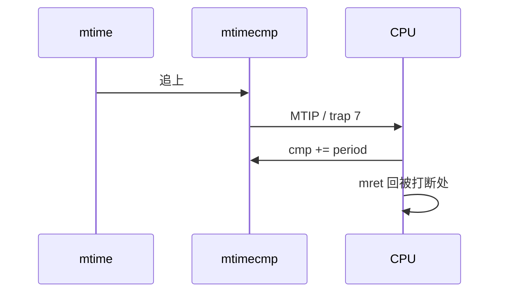

# 08 · CLINT 定时器中断 / 秒表

> 前置：03 trap。本课第一次走 **异步 trap**（中断），不是缺页或 ecall。  
> 对比 09：本课是 **本地** 机器定时器（编号 7）；09 是 PLIC 外部中断（编号 11）。

---

## 要证明的对比

| | 同步（03 / 04 ecall） | 本课定时器 |
|--|----------------------|------------|
| `mcause[63]` | 0 | **1** |
| 编号 | 2/3/5/8/9/11… | **7**（Machine timer interrupt） |
| `mepc` | 那条故障指令 | **被打断后要执行的那条** |
| `mret` | 软件常 `mepc+=2/4` 跳过 | **不要改 mepc**，否则丢一条指令 |
| 清 pending | 无（指令已过） | 推高 `mtimecmp`，**不能写 mip** |

| 键 | 期望 |
|----|------|
| `s` | 约 0.1s 跳一位，显示 `run` |
| `p` | 数字停 |
| `r` | `00:00.0` `stop` |

---

## 硬件路径

`mtime` 是 SoC 实时计数（K230 设备树 **27 MHz**），不是 `mcycle`（CPU 周期）。CPU1 上 `mcycle` 可能不走；本课只跑 CPU0。

CLINT `0xf04000000`（与 02 的 MSIP 同一块）：

| 寄存器 | 偏移 |
|--------|------|
| `msip[hart]` | `+ 4*hart` |
| `mtimecmp[0]` | `+0x4000` |
| `mtime` | `+0xbff8` |

设备树标注 `clint,has-no-64bit-mmio`：64 位数拆成两次 32-bit。写比较器顺序：

```text
低半 ← 0xffffffff     # 先抬高，避免撕裂后立刻再中断
高半 ← new[63:32]
低半 ← new[31:0]
```

上电 `mtimecmp` 常为 0，而 `mtime` 已经在走 → **MTIP 一上电就挂起**。`timer_init` 先把比较器写到 `~0`，再开 `mie.MTIE`。

```text
mtime >= mtimecmp
  → mip.MTIP
  → mie.MTIE 且 mstatus.MIE
  → mcause = 1<<63 | 7
  → mtvec → ISR：g_ticks++；g_cmp += period；写回 mtimecmp
  → mret（不改 mepc）
```



周期：`27e6 / 10 ≈ 2.7e6`（10 Hz）。走时明显快慢时，用实测 `mtime` 斜率改 `CLINT_TIMEBASE_HZ`，不要改成 `mcycle` 轮询——那就不再是中断实验。

`mideleg` **不能**委托 MTI（7）。机器定时器永远进 M。嵌套/委派是后面的课；本课 `mideleg=0`。

---

## 菜单

```text
启动后停表
s    开始     p    暂停     r    清零
h    帮助
```

ISR **不打串口**（避免和主循环 TX 轮询搅在一起）。主循环只读 `g_ticks` 画 `MM:SS.t`。

### 期望

`s` 后约 10 次/秒跳动。  
完全不跳：先确认 `mtime` 在递增。不递增就查 CLINT 基址/偏移。  
误进 UNEXPECTED TRAP：应是 `irq?=yes`、`code=7`。若变成 illegal，多半是 CSR/`mtvec` 没设好。  
数字乱飞：`mtimecmp` 没推高，level 式 pending 会连打。

---

## 常见误区

1. **「中断回来也要 skip `mepc`」**  
   那会丢掉被打断的那条指令。同步异常才 skip。

2. **「写 `mip` 清 MTIP」**  
   定时器 pending 由比较器硬件产生。只能让 `mtimecmp > mtime`。

3. **「`mtime` 就是 `mcycle`」**  
   一个跟 SoC 晶振，一个跟核时钟。本课秒表必须用 `mtime`。

4. **64 位一次 `sd` 写 mtimecmp**  
   K230 标注没有 64-bit MMIO，会撕开或写不进去。必须两次 32-bit。

5. **上电立刻开 `MTIE`**  
   `mtimecmp==0` 时会马上灌满中断。先 park 到 `~0`。

---

## 关键文件

| 文件 | 作用 |
|------|------|
| `src/timer.c` | park / start / 推高 cmp / `g_ticks` |
| `boards/k230/clint.c` | 32-bit 拆写 `mtime`/`mtimecmp` |
| `src/trap.c` | 识别中断 7，不改 mepc |
| `src/main.c` | 秒表菜单 |

---

## 不做

PLIC、S 态委托、CPU1 上的定时器。外部中断见 09。

---

## 构建

```bash
cd 08-timer && make
```

下一课：[09-irq](../../09-irq/docs/IRQ_CN.md)

返回：[本目录 README](../README.md) · [文档索引](../../docs/README.md)
