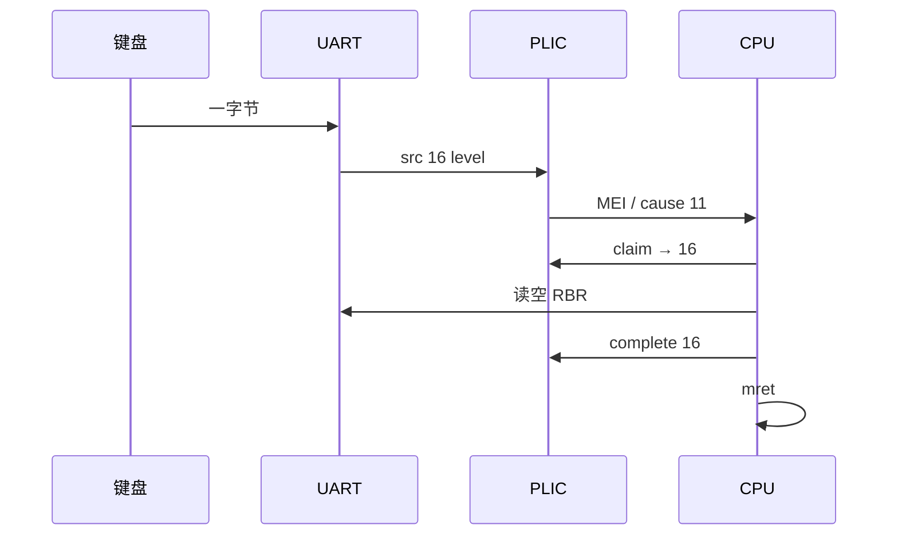

# 09 · UART RX / PLIC 外部中断

> 前置：08 本地定时器中断。本课：**敲键产生外部中断**，不是轮询 `LSR`。  
> `mcause` 最高位=1、编号 **11**（Machine external interrupt）。08 是编号 **7**。

---

## 要证明的对比

| | 08-timer | 本课 UART RX |
|--|----------|----------------|
| 来源 | CLINT `mtime` ≥ `mtimecmp` | UART0 收满一字节 |
| 汇聚 | 核本地 MTIP | **PLIC** 源 16 → MEI |
| `mcause` | `1<<63 \| 7` | `1<<63 \| 11` |
| 清 pending | 推高 `mtimecmp` | **读空 RBR** + PLIC complete |
| 菜单 | 秒表自己跳 | 键来自 ISR 环形缓冲 |

| 操作 | 期望 |
|------|------|
| 启动（已是 IRQ 模式）敲键 | `count` +1，`last` 为该字符 |
| `p` 后再敲 | 键仍可用（主循环 `uart_try_getc`），**count 不再加** |
| `i` 再敲 | `count` 又开始加 |
| 误进 UNEXPECTED | 应是 `irq?=yes` `code=11`，不是 7 |

---

## 硬件路径

```text
键 → UART0 RBR 满
  → IER.ERBFI
  → PLIC 源 16（level-high）
  → hart0 M 上下文（priority > threshold，enable 置位）
  → mip.MEIP → mie.MEIE → mstatus.MIE
  → mcause = 1<<63 | 11
  → ISR: claim → 抽干 RBR 进 32B ring、count++ → complete
  → mret（不改 mepc）
```

| 项 | 值 |
|----|-----|
| PLIC | `0xf00000000`（`thead,c900-plic`） |
| UART0 源号 | **16**（设备树；level） |
| hart0 M 上下文 | context **0**（claim/complete 用这个） |
| UART | `0x91400000`；开中断时 `IER.ERBFI=1` |
| 核上看到的 | 只有「外部中断 11」，**看不到源号**，必须 PLIC claim |

level 中断：FIFO/RBR 里还有字节就会一直 pending。ISR 必须 **while 读空**，再 complete。只 complete 不读 RBR → 连打，主循环被饿死。

ISR **不打串口**。TX 仍是主循环轮询 `LSR.THRE`；ISR 里再等 THRE 容易和自己重入搅在一起。



`p`：关 `IER.ERBFI`、清 `mie.MEIE`，主循环改回 `uart_try_getc`。键还能用，证明「有字符」和「走中断」是两件事。

---

## 菜单

```text
启动已是 IRQ 模式
任意键     count 应加 1（菜单键 i/p/h 也会加，因为先入 ring）
i          开 UART RX 中断
p          关中断，改回轮询
h          帮助
```

### 期望

IRQ 下 `count` 跟着键走。  
`p` 后 `count` 冻结，但 `last` 仍更新。  
完全没有中断：查 PLIC 使能/优先级/threshold、UART `IER`、`mie.MEIE`、源号是不是 16。  
claim 到非 16：可能是别的外设没屏蔽；本课只处理 16，其它源 complete 掉以免卡死。

---

## 常见误区

1. **「外部中断的编号就是 16」**  
   16 是 **PLIC 源号**。CPU 的 `mcause` 是 **11**。先 claim 才知道是谁。

2. **「和 08 一样 skip `mepc`」**  
   中断不 skip。

3. **「complete 了就干净」**  
   level：源还在断言（RBR 未空）会再次 pending。

4. **ISR 里 `uart_puts`**  
   和 TX 轮询、可能的重入搅在一起。本课禁止。

5. **轮询模式 count 还在加**  
   `IER` 或 `MEIE` 没关上。

---

## 关键文件

| 文件 | 作用 |
|------|------|
| `src/uart_irq.c` | `IER`、ring、count、claim/complete |
| `boards/k230/plic.c` | 源 16、context 0 |
| `src/trap.c` | 中断 11 → `uart_irq_on_mei`；不改 mepc |
| `src/main.c` | `i`/`p` 与状态行 |

---

## 不做

S 态委派、嵌套抢占、多源优先级演示。本课只建立「键 → PLIC → cause 11」。  
下一课起进入线程与同步线：[10-thread](../../10-thread/)（规划）→ … → [12-atomic](../../12-atomic/docs/ATOMIC_CN.md)。

---

## 构建

```bash
cd 09-irq && make
```

下一课：[10-thread](../../10-thread/docs/THREAD_CN.md)（规划）· 原子课：[12-atomic](../../12-atomic/docs/ATOMIC_CN.md)

返回：[本目录 README](../README.md) · [文档索引](../../docs/README.md)
